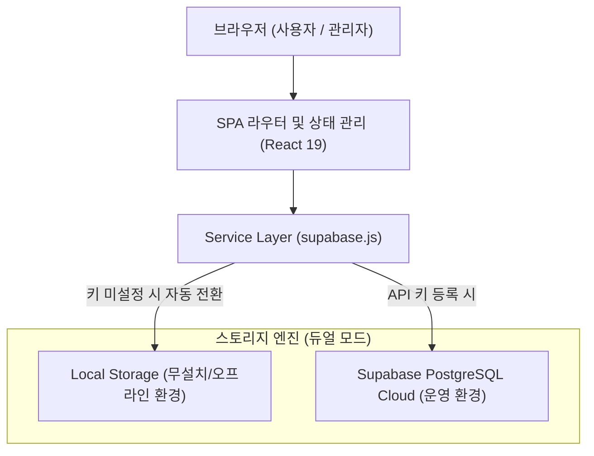

# 📘 학과 소통 & 불만 접수 게시판 개발설명서 및 사용자 매뉴얼

본 문서는 학과 구성원을 위한 **소통 & 불만 접수 게시판 웹 애플리케이션**의 개발 아키텍처, 기술 명세, 데이터 모델, 보안 규칙 및 상세 사용자 매뉴얼을 담고 있습니다.

---

## 📑 목차
1. [프로젝트 개요](#1-프로젝트-개요)
2. [기술 스택 및 아키텍처](#2-기술-스택-및-아키텍처)
3. [디렉터리 구조 및 파일 명세](#3-디렉터리-구조-및-파일-명세)
4. [데이터베이스 모델 및 스키마 설계](#4-데이터베이스-모델-및-스키마-설계)
5. [핵심 기능 구현 명세](#5-핵심-기능-구현-명세)
6. [사용자 매뉴얼 (화면별 사용 가이드)](#6-사용자-매뉴얼-화면별-사용-가이드)
7. [환경 설정 및 배포 가이드](#7-환경-설정-및-배포-가이드)

---

## 1. 프로젝트 개요
* **프로젝트명**: 학과 소통 & 불만 접수 게시판 (Complaint Board)
* **목적**: 학과 구성원(학생, 교수, 조교, 행정실)이 학과 운영 건의, 시설 불만, 학사 질의를 자유롭게 공유하고, 관리자(학과 학생회/행정실)가 체계적으로 피드백을 전달할 수 있는 안전하고 신뢰성 높은 폐쇄형 웹 게시판 구축.
* **주요 특징**:
  * 외부인 접근을 원천 차단하는 학과 전용 로그인 게이트.
  * 클라우드 DB(Supabase)와 무설치 브라우저 DB(LocalStorage)의 완벽한 **듀얼 모드 지원** (네트워크나 외부 키 없이도 100% 자가 구동).
  * 엄격한 권한 분립 (작성자 비밀번호 기반 수정/삭제, 일반 독자 임의 조작 방지, 관리자의 규정 위반 통보 삭제 및 감사 로그 기록).
  * 규정에 따른 댓글 정책 (일반 건의글: 전원 댓글 가능 / 공지사항: 댓글 작성 엄격 차단).
  * 사진 갤러리(미리보기, 원본 확대 모달) 및 파일 다운로드 첨부 기능.
  * 내 글에 댓글이 달렸을 때 실시간 알림 벨 아이콘 및 뱃지 알림 시스템.

---

## 2. 기술 스택 및 아키텍처



### 2.1 프론트엔드
* **Core**: React 19, JavaScript (ES Modules)
* **Build Tool**: Vite 8 (초고속 HMR 및 최적화 번들링)
* **Icons**: `lucide-react` (모던하고 일관된 아이콘 시스템)
* **Styling**: Pure CSS3 (Flexbox/Grid, CSS Variables, 반응형 모바일 대응 디자인)

### 2.2 백엔드 & 스토리지 (Dual-Engine)
1. **Supabase Cloud Engine** (운영 및 정식 배포용):
   * PostgreSQL 15 기반 관계형 데이터베이스
   * Row Level Security (RLS) 데이터 무결성 보장
   * RPC 함수(`increment_views`, `increment_likes`, `admin_delete_post`, `admin_delete_comment`)
2. **Local Fallback Engine** (과제 평가 및 개발/오프라인용):
   * 브라우저 `localStorage` 기반 가상 데이터베이스
   * 외부 통신 0바이트, 개인정보 유출 위험 없는 완전 격리 구조
   * 신규 실행 시 기본 시드 데이터(공지사항, 예시 건의글) 자동 생성

---

## 3. 디렉터리 구조 및 파일 명세

```
complaint-board2/
├── index.html                   # 메인 진입 HTML (file:// 프로토콜 감지 및 안내 내장)
├── package.json                 # 프로젝트 의존성 및 스크립트 정의
├── vite.config.js               # Vite 개발 및 빌드 환경설정 (포트 3000 고정)
├── vercel.json                  # Vercel SPA 라우팅 리다이렉트 설정
├── .env.example                 # Supabase 환경 변수 샘플
├── .env.local                   # 로컬 환경 변수 파일 (Git 제외)
├── .gitignore                   # 형상 관리 제외 규칙
├── 게시판_실행.bat              # Windows 환경 1클릭 자동 실행 스크립트
├── supabase/
│   └── schema.sql               # Supabase 전체 테이블, RLS 정책, RPC 함수 정의 SQL
├── src/
│   ├── main.jsx                 # React 애플리케이션 진입점
│   ├── App.jsx                  # 최상위 컴포넌트, 모달 및 뷰 라우팅, 알림 상태 관리
│   ├── index.css                # 전체 스타일시트 (테마, 컴포넌트, 반응형 디자인)
│   ├── lib/
│   │   └── supabase.js          # Supabase SDK 초기화 및 로컬 스토리지 서비스 계층
│   └── components/
│       ├── AuthScreen.jsx       # 로그인/회원가입 게이트 및 테스트 계정 자동 입력
│       ├── Header.jsx           # 로고, 알림 드롭다운, 관리자 토글, 사용자 프로필
│       ├── PostCard.jsx         # 게시글 카드 컴포넌트 (상태 뱃지, 첨부 표시, 좋아요)
│       ├── PostDetailModal.jsx  # 게시글 상세 조회, 댓글 목록/작성, 첨부파일 다운로드
│       ├── PostWriteModal.jsx   # 게시글 작성 및 수정 모달 (파일/이미지 첨부 지원)
│       ├── NotificationDropdown.jsx # 댓글 알림 확인 및 바로가기 모달
│       ├── MyCommentsView.jsx   # 내가 작성한 댓글 모아보기 전용 뷰
│       ├── AdminAuditLogsView.jsx   # 관리자 규정 위반 삭제 감사 로그 뷰
│       └── AdminNoticeDeleteModal.jsx # 관리자 삭제 사유 선택 및 통보 모달
```

---

## 4. 데이터베이스 모델 및 스키마 설계

### 4.1 `posts` (게시글 테이블)
| 필드명 | 타입 | 설명 |
| :--- | :--- | :--- |
| `id` | BIGSERIAL / Number | 기본키 (Primary Key) |
| `category` | VARCHAR(50) | 분류 ('불만/건의', '시설/환경', '학사/수업', '공지사항', '기타') |
| `title` | VARCHAR(255) | 게시글 제목 |
| `content` | TEXT | 게시글 본문 |
| `author` | VARCHAR(100) | 작성자 이름 또는 '익명' |
| `is_anonymous` | BOOLEAN | 익명 여부 |
| `password` | VARCHAR(255) | 수정/삭제용 비밀번호 (해시 또는 평문) |
| `author_token` | VARCHAR(100) | 브라우저별 작성자 고유 식별 토큰 |
| `status` | VARCHAR(30) | 처리 상태 ('접수대기', '처리중', '답변완료', '공지') |
| `visibility` | VARCHAR(20) | 공개 범위 ('public', 'private') |
| `allow_likes` | BOOLEAN | 공감(좋아요) 허용 여부 |
| `allow_comments` | BOOLEAN | 댓글 허용 여부 (공지사항은 항상 `false`) |
| `attachments` | JSONB / Array | 첨부 이미지(Base64) 및 파일 메타데이터 배열 |
| `views` | INTEGER | 조회수 |
| `likes` | INTEGER | 공감 수 |
| `created_at` | TIMESTAMPTZ | 작성 일시 |
| `updated_at` | TIMESTAMPTZ | 최종 수정 일시 |

### 4.2 `comments` (댓글 테이블)
| 필드명 | 타입 | 설명 |
| :--- | :--- | :--- |
| `id` | BIGSERIAL / Number | 기본키 |
| `post_id` | BIGINT | 부모 게시글 참조 외래키 |
| `author` | VARCHAR(100) | 댓글 작성자 이름 |
| `is_anonymous` | BOOLEAN | 익명 여부 |
| `content` | TEXT | 댓글 내용 |
| `password` | VARCHAR(255) | 댓글 삭제용 비밀번호 |
| `author_token` | VARCHAR(100) | 작성자 식별 토큰 |
| `created_at` | TIMESTAMPTZ | 작성 일시 |

### 4.3 `notifications` (댓글 알림 테이블)
| 필드명 | 타입 | 설명 |
| :--- | :--- | :--- |
| `id` | BIGSERIAL / Number | 기본키 |
| `recipient_token` | VARCHAR(100) | 알림을 받을 원글 작성자의 토큰 |
| `post_id` | BIGINT | 대상 게시글 ID |
| `post_title` | VARCHAR(255) | 대상 게시글 제목 |
| `sender_name` | VARCHAR(100) | 댓글 작성자 |
| `comment_content` | TEXT | 댓글 내용 요약 |
| `is_read` | BOOLEAN | 읽음 여부 |
| `created_at` | TIMESTAMPTZ | 알림 발생 일시 |

### 4.4 `admin_audit_logs` (관리자 삭제 감사 기록)
| 필드명 | 타입 | 설명 |
| :--- | :--- | :--- |
| `id` | BIGSERIAL / Number | 기본키 |
| `target_type` | VARCHAR(20) | 삭제 대상 ('post', 'comment') |
| `target_id` | BIGINT | 대상 ID |
| `target_title` | VARCHAR(255) | 삭제된 글의 제목 또는 댓글 요약 |
| `reason` | VARCHAR(255) | 규정 위반 사유 (욕설/비방, 허위사실, 도배 등) |
| `admin_id` | VARCHAR(100) | 처리 관리자 계정명 |
| `deleted_at` | TIMESTAMPTZ | 조치 일시 |

---

## 5. 핵심 기능 구현 명세

### 5.1 폐쇄형 인증 게이트 (`AuthScreen.jsx`)
* 외부인 접근 방지를 위해 최초 웹 접속 시 게시판 대신 인증 화면이 먼저 렌더링됩니다.
* **실험/과제용 계정 원클릭 로그인**: 상단의 `[이 계정으로 자동 입력하기]` 버튼을 누르면 테스트 아이디(`abcd`)와 비밀번호(`1234`)가 즉시 채워져 바로 진입할 수 있습니다.
* 새로운 아이디로 회원가입을 하여 다중 사용자로 분리 테스트할 수 있습니다.

### 5.2 권한 분립 및 작성자 보호 정책
1. **일반 독자**: 타인의 게시글이나 댓글을 절대 수정/삭제할 수 없습니다.
2. **글쓴이 (본인)**:
   * 글 작성 시 설정한 비밀번호로 본인의 글을 언제든지 수정하거나 삭제할 수 있습니다.
   * 브라우저에 본인의 작성 이력이 자동 보관되어 비밀번호가 자동으로 프리필됩니다.
3. **관리자 (Admin)**:
   * 일반 사용자의 글이나 댓글 내용을 **임의로 변조/수정할 수 없습니다.**
   * 단, 학과 규정에 위배되는 게시물에 대해 **사유(욕설/비방, 명예훼손, 도배 등)를 입력하고 통보 후 강제 삭제**할 수 있습니다.
   * 모든 삭제 조치는 투명하게 `감사 이력(Audit Log)`에 영구 기록되어 권력 남용을 방지합니다.

### 5.3 댓글 작성 제약 규칙
* **일반 건의/질문 글**: 모든 학과 구성원이 자유롭게 의견을 나누고 댓글을 달 수 있습니다.
* **관리자 공지사항 (`category === '공지사항'`)**:
  * 공지사항 글은 중요 학사 안내의 왜곡을 방지하기 위해 **댓글 작성창이 완전히 비활성화**되며 *"공지사항 게시글에는 댓글을 작성할 수 없습니다"*라는 시스템 안내문이 표시됩니다.

### 5.4 멀티미디어 첨부 (이미지 & 파일)
* **이미지 첨부**: JPG, PNG, GIF, WebP 형식 지원.
  * 게시글 카드에서 썸네일 미리보기 지원.
  * 상세 모달에서 갤러리 형태로 표시되며, 클릭 시 **화면 전체 원본 확대 모달** 지원.
* **파일 첨부**: PDF, HWP, ZIP, TXT 등 문서 및 과제 파일 첨부 지원.
  * 파일 형식별 아이콘, 용량 표시, 브라우저 원클릭 다운로드 기능 지원.

### 5.5 댓글 알림 센터 (`NotificationDropdown.jsx`)
* 내가 올린 건의글에 누군가 댓글을 달면, 상단 헤더의 종 모양(🔔) 아이콘에 **빨간색 뱃지와 안 읽은 알림 개수**가 즉시 표시됩니다.
* 종 아이콘을 클릭하면 드롭다운으로 알림 내역이 펼쳐지며, 알림을 클릭하면 **해당 게시글로 즉시 자동 스크롤 및 열람**됩니다.

---

## 6. 사용자 매뉴얼 (화면별 사용 가이드)

### 6.1 로그인 / 회원가입 화면
1. 브라우저로 `http://localhost:3000`에 접속합니다.
2. 화면 중앙의 보라색 안내 박스에 표시된 **[이 계정으로 자동 입력하기]** 버튼을 클릭합니다.
3. **[로그인하기]** 버튼을 누르면 학과 게시판 메인 화면으로 이동합니다.
*(※ 다른 이름으로 테스트하고 싶다면 [신규 회원가입] 탭을 눌러 자유롭게 계정을 만드실 수 있습니다.)*

### 6.2 게시판 메인 둘러보기
* **카테고리 탭**: `전체`, `불만/건의`, `시설/환경`, `학사/수업`, `공지사항` 탭을 눌러 원하는 분류의 글만 모아볼 수 있습니다.
* **나의 활동 탭**:
  * **[내가 작성한 글]**: 내가 쓴 글만 필터링하여 보여줍니다.
  * **[내가 작성한 댓글]**: 내가 남긴 댓글들을 목록으로 모아보고 해당 글로 바로 이동합니다.
* **검색 & 정렬**: 제목/내용/작성자 키워드 검색, 최신순/조회수순/공감순 정렬 기능을 지원합니다.

### 6.3 새 글 작성하기
1. 상단 우측의 **[+ 새 글 작성]** 버튼을 클릭합니다.
2. 카테고리를 선택하고 제목과 본문을 작성합니다.
3. 익명 체크박스를 누르면 실명 대신 '익명'으로 안전하게 접수됩니다.
4. 비밀번호를 입력합니다 (추후 수정/삭제에 사용).
5. 이미지나 문서 파일이 있다면 [사진/파일 첨부] 버튼을 통해 추가합니다.
6. **[게시글 등록하기]** 버튼을 클릭합니다.

### 6.4 게시글 상세 조회 및 댓글 작성
1. 게시글 카드를 클릭하면 상세 모달이 열리며 조회수가 1 증가합니다.
2. 하단의 **[공감(하트)]** 버튼을 눌러 건의사항에 힘을 실어줄 수 있습니다.
3. 일반 글인 경우 하단 댓글창에서 이름(또는 익명)과 내용을 입력하여 댓글을 등록합니다.
*(공지사항 글인 경우 댓글창이 잠겨 있습니다.)*
4. 본인의 글/댓글인 경우 [수정] 또는 [삭제] 버튼을 눌러 비밀번호 확인 후 처리할 수 있습니다.

### 6.5 관리자 모드 활용
1. 상단 우측의 **[🛡️ 관리자 모드]** 버튼을 클릭합니다.
2. 관리자 인증 암호(`admin2026!`)를 입력합니다.
3. 관리자 모드가 켜지면 상단에 [관리자 감사 기록] 탭이 활성화되며, 모든 글과 댓글에 빨간색 **[규정위반 삭제]** 버튼이 노출됩니다.
4. 규정에 맞지 않는 글 삭제 시 사유를 선택하고 삭제하면, 감사 이력에 처리 내역이 영구 저장됩니다.

---

## 7. 환경 설정 및 배포 가이드

### 7.1 로컬 실행 (평가자 / 교수님용)
```bash
# 1. 의존성 패키지 설치 (최초 1회 필수)
npm install

# 2. 로컬 개발 서버 구동 (localhost:3000)
npm run dev
```
*(Windows 사용자는 `게시판_실행.bat` 더블 클릭으로도 구동 가능합니다.)*

### 7.2 Vercel 무료 웹 배포 (클라우드 링크 제출 시)
1. 코드를 GitHub 개인 저장소에 Push합니다.
2. [Vercel](https://vercel.com)에 로그인 후 해당 저장소를 Import합니다.
3. 루트에 이미 포함된 [`vercel.json`](file:///C:/Users/2026000396/source/complaint-board2/vercel.json)에 의해 별도 설정 없이 **[Deploy]** 버튼을 누르면 1분 만에 `https://xxx.vercel.app` 형태의 배포 링크가 완성됩니다.
4. 배포 사이트에서도 로컬 스토리지 모드가 기본 작동하므로 누구나 즉시 테스트 가능합니다.

### 7.3 Supabase 클라우드 DB 연결 (선택 사항)
실제 영구 클라우드 DB와 연결을 원하실 경우:
1. Supabase에서 새 프로젝트를 생성합니다.
2. `supabase/schema.sql`의 SQL 스크립트를 SQL Editor에 복사하여 실행합니다.
3. `.env.local` 파일에 프로젝트 URL과 anon 키를 입력하시면 클라우드 모드로 자동 승격됩니다.

